<!--
  Generated by scripts/readme.py: do not edit by hand.
  English version of README.md: the same SVG pieces, with the texts of
  datos/perfil.en.json, published in the `salida` branch. The ES | EN switch
  goes back to the Spanish profile. Each project row is its own link, to open
  the demo or the repository.
-->

<a href="https://github.com/Jhonttt"><picture><source media="(prefers-color-scheme: dark)" srcset="https://raw.githubusercontent.com/Jhonttt/Jhonttt/salida/interruptor-idioma-en-dark.svg"></picture></a>

<picture><source media="(max-width: 767px) and (prefers-color-scheme: dark)" srcset="https://raw.githubusercontent.com/Jhonttt/Jhonttt/salida/banner-movil-en-dark.svg"><source media="(max-width: 767px)" srcset="https://raw.githubusercontent.com/Jhonttt/Jhonttt/salida/banner-movil-en-light.svg"><source media="(prefers-color-scheme: dark)" srcset="https://raw.githubusercontent.com/Jhonttt/Jhonttt/salida/banner-en-dark.svg"></picture>
<a href="https://juanatahona.dev"><picture><source media="(max-width: 767px) and (prefers-color-scheme: dark)" srcset="https://raw.githubusercontent.com/Jhonttt/Jhonttt/salida/contacto-web-movil-dark.svg"><source media="(max-width: 767px)" srcset="https://raw.githubusercontent.com/Jhonttt/Jhonttt/salida/contacto-web-movil-light.svg"><source media="(prefers-color-scheme: dark)" srcset="https://raw.githubusercontent.com/Jhonttt/Jhonttt/salida/contacto-web-dark.svg">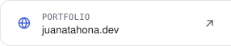</picture></a><a href="https://www.linkedin.com/in/juan-atahona/"><picture><source media="(max-width: 767px) and (prefers-color-scheme: dark)" srcset="https://raw.githubusercontent.com/Jhonttt/Jhonttt/salida/contacto-linkedin-movil-dark.svg"><source media="(max-width: 767px)" srcset="https://raw.githubusercontent.com/Jhonttt/Jhonttt/salida/contacto-linkedin-movil-light.svg"><source media="(prefers-color-scheme: dark)" srcset="https://raw.githubusercontent.com/Jhonttt/Jhonttt/salida/contacto-linkedin-dark.svg">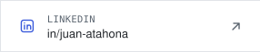</picture></a><a href="mailto:juan.atahona4@gmail.com"><picture><source media="(max-width: 767px) and (prefers-color-scheme: dark)" srcset="https://raw.githubusercontent.com/Jhonttt/Jhonttt/salida/contacto-email-movil-dark.svg"><source media="(max-width: 767px)" srcset="https://raw.githubusercontent.com/Jhonttt/Jhonttt/salida/contacto-email-movil-light.svg"><source media="(prefers-color-scheme: dark)" srcset="https://raw.githubusercontent.com/Jhonttt/Jhonttt/salida/contacto-email-dark.svg">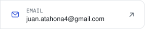</picture></a>
<picture><source media="(max-width: 767px) and (prefers-color-scheme: dark)" srcset="https://raw.githubusercontent.com/Jhonttt/Jhonttt/salida/sobre-mi-movil-en-dark.svg"><source media="(max-width: 767px)" srcset="https://raw.githubusercontent.com/Jhonttt/Jhonttt/salida/sobre-mi-movil-en-light.svg"><source media="(prefers-color-scheme: dark)" srcset="https://raw.githubusercontent.com/Jhonttt/Jhonttt/salida/sobre-mi-en-dark.svg">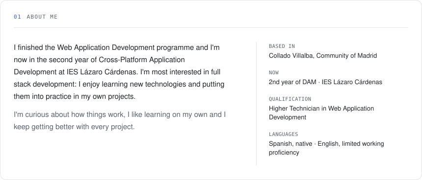</picture>
<picture><source media="(max-width: 767px) and (prefers-color-scheme: dark)" srcset="https://raw.githubusercontent.com/Jhonttt/Jhonttt/salida/trayectoria-movil-en-dark.svg"><source media="(max-width: 767px)" srcset="https://raw.githubusercontent.com/Jhonttt/Jhonttt/salida/trayectoria-movil-en-light.svg"><source media="(prefers-color-scheme: dark)" srcset="https://raw.githubusercontent.com/Jhonttt/Jhonttt/salida/trayectoria-en-dark.svg">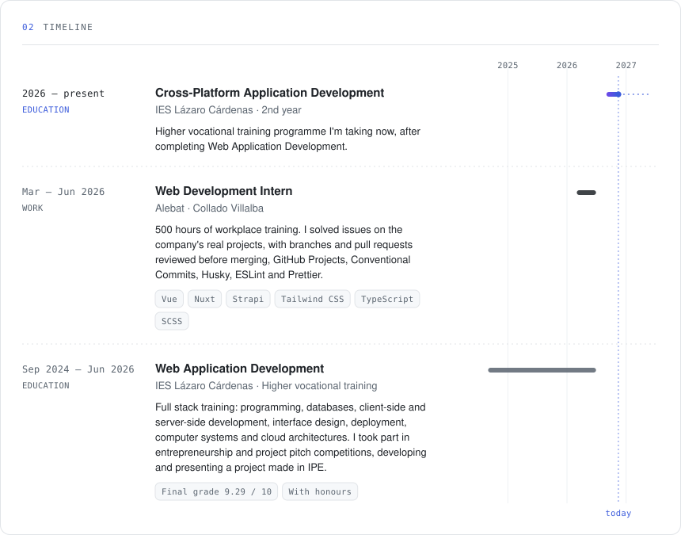</picture>
<picture><source media="(max-width: 767px) and (prefers-color-scheme: dark)" srcset="https://raw.githubusercontent.com/Jhonttt/Jhonttt/salida/stack-movil-en-dark.svg"><source media="(max-width: 767px)" srcset="https://raw.githubusercontent.com/Jhonttt/Jhonttt/salida/stack-movil-en-light.svg"><source media="(prefers-color-scheme: dark)" srcset="https://raw.githubusercontent.com/Jhonttt/Jhonttt/salida/stack-en-dark.svg">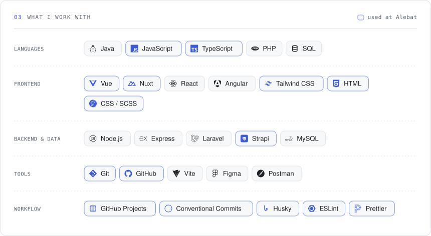</picture>
<picture><source media="(max-width: 767px) and (prefers-color-scheme: dark)" srcset="https://raw.githubusercontent.com/Jhonttt/Jhonttt/salida/proyectos-movil-en-dark.svg"><source media="(max-width: 767px)" srcset="https://raw.githubusercontent.com/Jhonttt/Jhonttt/salida/proyectos-movil-en-light.svg"><source media="(prefers-color-scheme: dark)" srcset="https://raw.githubusercontent.com/Jhonttt/Jhonttt/salida/proyectos-en-dark.svg">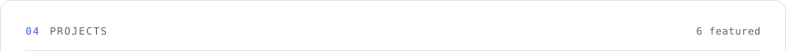</picture><a href="https://serena-app-rust.vercel.app"><picture><source media="(max-width: 767px) and (prefers-color-scheme: dark)" srcset="https://raw.githubusercontent.com/Jhonttt/Jhonttt/salida/proyecto-1-movil-en-dark.svg"><source media="(max-width: 767px)" srcset="https://raw.githubusercontent.com/Jhonttt/Jhonttt/salida/proyecto-1-movil-en-light.svg"><source media="(prefers-color-scheme: dark)" srcset="https://raw.githubusercontent.com/Jhonttt/Jhonttt/salida/proyecto-1-en-dark.svg">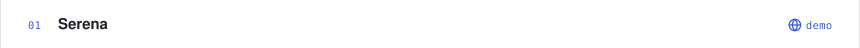</picture></a><a href="https://github.com/Jhonttt/di-dashboard-gestion-incidencias-atahona-sergeev"><picture><source media="(max-width: 767px) and (prefers-color-scheme: dark)" srcset="https://raw.githubusercontent.com/Jhonttt/Jhonttt/salida/proyecto-2-movil-en-dark.svg"><source media="(max-width: 767px)" srcset="https://raw.githubusercontent.com/Jhonttt/Jhonttt/salida/proyecto-2-movil-en-light.svg"><source media="(prefers-color-scheme: dark)" srcset="https://raw.githubusercontent.com/Jhonttt/Jhonttt/salida/proyecto-2-en-dark.svg">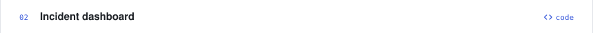</picture></a><a href="https://twitch-clone-opal.vercel.app"><picture><source media="(max-width: 767px) and (prefers-color-scheme: dark)" srcset="https://raw.githubusercontent.com/Jhonttt/Jhonttt/salida/proyecto-3-movil-en-dark.svg"><source media="(max-width: 767px)" srcset="https://raw.githubusercontent.com/Jhonttt/Jhonttt/salida/proyecto-3-movil-en-light.svg"><source media="(prefers-color-scheme: dark)" srcset="https://raw.githubusercontent.com/Jhonttt/Jhonttt/salida/proyecto-3-en-dark.svg">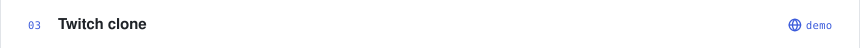</picture></a><a href="https://github.com/Jhonttt/proyecto-intermodular"><picture><source media="(max-width: 767px) and (prefers-color-scheme: dark)" srcset="https://raw.githubusercontent.com/Jhonttt/Jhonttt/salida/proyecto-4-movil-en-dark.svg"><source media="(max-width: 767px)" srcset="https://raw.githubusercontent.com/Jhonttt/Jhonttt/salida/proyecto-4-movil-en-light.svg"><source media="(prefers-color-scheme: dark)" srcset="https://raw.githubusercontent.com/Jhonttt/Jhonttt/salida/proyecto-4-en-dark.svg"></picture></a><a href="https://juanatahona.dev"><picture><source media="(max-width: 767px) and (prefers-color-scheme: dark)" srcset="https://raw.githubusercontent.com/Jhonttt/Jhonttt/salida/proyecto-5-movil-en-dark.svg"><source media="(max-width: 767px)" srcset="https://raw.githubusercontent.com/Jhonttt/Jhonttt/salida/proyecto-5-movil-en-light.svg"><source media="(prefers-color-scheme: dark)" srcset="https://raw.githubusercontent.com/Jhonttt/Jhonttt/salida/proyecto-5-en-dark.svg">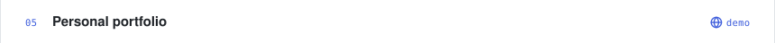</picture></a><a href="https://github.com/Jhonttt/diw-u2-localhub-atahona-toro"><picture><source media="(max-width: 767px) and (prefers-color-scheme: dark)" srcset="https://raw.githubusercontent.com/Jhonttt/Jhonttt/salida/proyecto-6-movil-en-dark.svg"><source media="(max-width: 767px)" srcset="https://raw.githubusercontent.com/Jhonttt/Jhonttt/salida/proyecto-6-movil-en-light.svg"><source media="(prefers-color-scheme: dark)" srcset="https://raw.githubusercontent.com/Jhonttt/Jhonttt/salida/proyecto-6-en-dark.svg">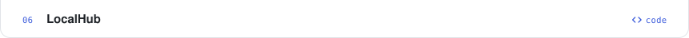</picture></a>
<picture><source media="(max-width: 767px) and (prefers-color-scheme: dark)" srcset="https://raw.githubusercontent.com/Jhonttt/Jhonttt/salida/actividad-movil-en-dark.svg"><source media="(max-width: 767px)" srcset="https://raw.githubusercontent.com/Jhonttt/Jhonttt/salida/actividad-movil-en-light.svg"><source media="(prefers-color-scheme: dark)" srcset="https://raw.githubusercontent.com/Jhonttt/Jhonttt/salida/actividad-en-dark.svg"></picture>
 Generated with Python from <a href="datos/perfil.en.json"><code>datos/perfil.en.json</code></a> · activity refreshes every hour

