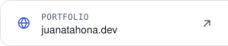
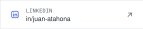
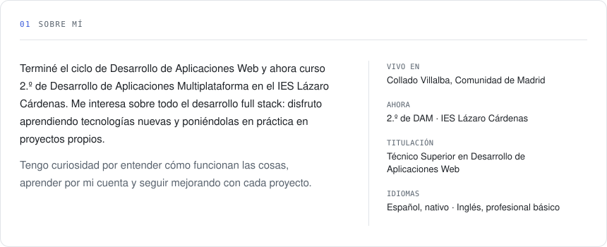
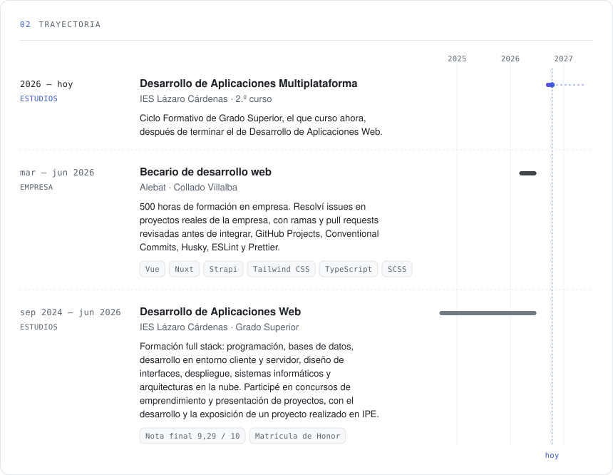
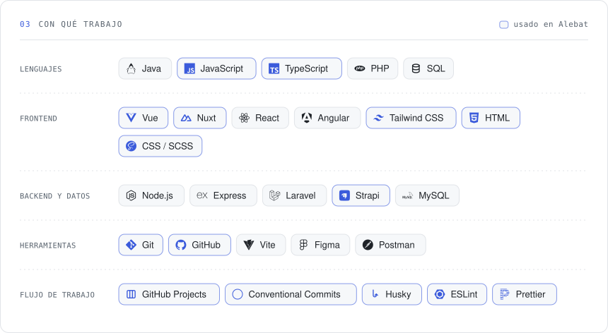
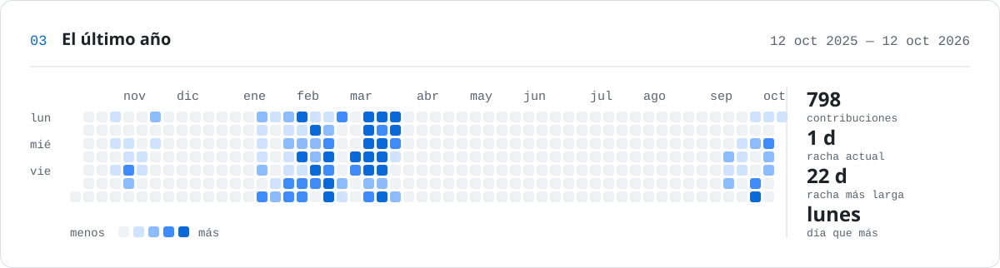

<!--
  Todo lo que se ve son SVG generados con Python desde datos/perfil.json
  (scripts/). Para cambiar algo, edita ese JSON y el workflow "Perfil" lo
  vuelve a dibujar; la actividad se refresca sola cada día.
  Va todo en un único bloque HTML, sin líneas en blanco: así las piezas quedan
  a la misma distancia unas de otras. Los tres enlaces de contacto van pegados,
  sin espacios entre ellos, para que formen una sola barra.
-->

<picture><source media="(prefers-color-scheme: dark)" srcset="assets/banner-dark.svg"></picture>
<a href="https://juanatahona.dev"><picture><source media="(prefers-color-scheme: dark)" srcset="assets/contacto-web-dark.svg"></picture></a><a href="https://www.linkedin.com/in/juan-atahona/"><picture><source media="(prefers-color-scheme: dark)" srcset="assets/contacto-linkedin-dark.svg"></picture></a><a href="mailto:juan.atahona4@gmail.com"><picture><source media="(prefers-color-scheme: dark)" srcset="assets/contacto-email-dark.svg"></picture></a>
<picture><source media="(prefers-color-scheme: dark)" srcset="assets/sobre-mi-dark.svg"></picture>
<picture><source media="(prefers-color-scheme: dark)" srcset="assets/trayectoria-dark.svg"></picture>
<picture><source media="(prefers-color-scheme: dark)" srcset="assets/stack-dark.svg"></picture>
<picture><source media="(prefers-color-scheme: dark)" srcset="assets/actividad-dark.svg"></picture>
 Generado con Python desde <a href="datos/perfil.json"><code>datos/perfil.json</code></a> · la actividad se actualiza sola cada día

