<picture><source media="(prefers-color-scheme: dark)" srcset="assets/banner-dark.svg"></picture>

<a href="https://juanatahona.dev"><picture><source media="(prefers-color-scheme: dark)" srcset="assets/portfolio-dark.svg"></picture></a>&nbsp;
<a href="https://www.linkedin.com/in/juan-atahona/"><picture><source media="(prefers-color-scheme: dark)" srcset="assets/linkedin-dark.svg"></picture></a>&nbsp;
<a href="mailto:juan.atahona4@gmail.com"><picture><source media="(prefers-color-scheme: dark)" srcset="assets/email-dark.svg"></picture></a>

 

### Sobre mí

¡Hola! Soy Juan, estudiante de 2º de DAM en España.

- Aquí guardo lo que hago en clase y los proyectos que hago por mi cuenta.
- Ahora mismo estoy con un juego de Pokémon para el navegador.
- Me gusta probar tecnologías nuevas y entender cómo funcionan las cosas por dentro.

 

### Stack

<!-- Las comas de la URL van como %2C: en srcset, una coma corta la URL. -->

<b>FRONTEND</b> 
<picture><source media="(prefers-color-scheme: dark)" srcset="https://skillicons.dev/icons?i=react%2Cnextjs%2Cvue%2Cnuxtjs%2Cangular%2Cts%2Ctailwind%2Chtml%2Ccss&theme=dark"></picture>

<b>BACKEND</b> 
<picture><source media="(prefers-color-scheme: dark)" srcset="https://skillicons.dev/icons?i=nodejs%2Cexpress%2Claravel%2Cphp%2Cjava&theme=dark"></picture>

<b>DATOS</b> 
<picture><source media="(prefers-color-scheme: dark)" srcset="https://skillicons.dev/icons?i=mysql%2Cpostgres%2Cmongodb&theme=dark"></picture>

<b>HERRAMIENTAS</b> 
<picture><source media="(prefers-color-scheme: dark)" srcset="https://skillicons.dev/icons?i=git%2Cgithub%2Cgithubactions%2Cvercel%2Cvitest%2Cfigma&theme=dark"></picture>

 

Juan Atahona · España · <a href="https://juanatahona.dev">juanatahona.dev</a>

