<!--
  Lo genera scripts/readme.py: no lo edites a mano.
  Todo lo que se ve son SVG generados con Python desde datos/perfil.json
  (scripts/), publicados en la rama `salida`. Cada <picture> elige la versión
  de móvil o la de escritorio según el ancho de la pantalla, y la clara o la
  oscura según el tema. Va todo en un único bloque HTML, sin líneas en blanco,
  y los tres enlaces de contacto pegados, para que formen una sola barra.
  Cada fila de proyectos va en su propio enlace, para abrir la demo o el repositorio.
  La versión en inglés es README.en.md; el interruptor ES | EN lleva de una a otra.
-->

<a href="https://github.com/Jhonttt/Jhonttt/blob/main/README.en.md"><picture><source media="(prefers-color-scheme: dark)" srcset="https://raw.githubusercontent.com/Jhonttt/Jhonttt/salida/interruptor-idioma-dark.svg"></picture></a>

<picture><source media="(max-width: 767px) and (prefers-color-scheme: dark)" srcset="https://raw.githubusercontent.com/Jhonttt/Jhonttt/salida/banner-movil-dark.svg"><source media="(max-width: 767px)" srcset="https://raw.githubusercontent.com/Jhonttt/Jhonttt/salida/banner-movil-light.svg"><source media="(prefers-color-scheme: dark)" srcset="https://raw.githubusercontent.com/Jhonttt/Jhonttt/salida/banner-dark.svg"></picture>
<a href="https://juanatahona.dev"><picture><source media="(max-width: 767px) and (prefers-color-scheme: dark)" srcset="https://raw.githubusercontent.com/Jhonttt/Jhonttt/salida/contacto-web-movil-dark.svg"><source media="(max-width: 767px)" srcset="https://raw.githubusercontent.com/Jhonttt/Jhonttt/salida/contacto-web-movil-light.svg"><source media="(prefers-color-scheme: dark)" srcset="https://raw.githubusercontent.com/Jhonttt/Jhonttt/salida/contacto-web-dark.svg">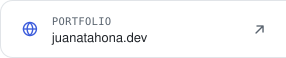</picture></a><a href="https://www.linkedin.com/in/juan-atahona/"><picture><source media="(max-width: 767px) and (prefers-color-scheme: dark)" srcset="https://raw.githubusercontent.com/Jhonttt/Jhonttt/salida/contacto-linkedin-movil-dark.svg"><source media="(max-width: 767px)" srcset="https://raw.githubusercontent.com/Jhonttt/Jhonttt/salida/contacto-linkedin-movil-light.svg"><source media="(prefers-color-scheme: dark)" srcset="https://raw.githubusercontent.com/Jhonttt/Jhonttt/salida/contacto-linkedin-dark.svg">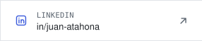</picture></a><a href="mailto:juan.atahona4@gmail.com"><picture><source media="(max-width: 767px) and (prefers-color-scheme: dark)" srcset="https://raw.githubusercontent.com/Jhonttt/Jhonttt/salida/contacto-email-movil-dark.svg"><source media="(max-width: 767px)" srcset="https://raw.githubusercontent.com/Jhonttt/Jhonttt/salida/contacto-email-movil-light.svg"><source media="(prefers-color-scheme: dark)" srcset="https://raw.githubusercontent.com/Jhonttt/Jhonttt/salida/contacto-email-dark.svg">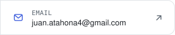</picture></a>
<picture><source media="(max-width: 767px) and (prefers-color-scheme: dark)" srcset="https://raw.githubusercontent.com/Jhonttt/Jhonttt/salida/sobre-mi-movil-dark.svg"><source media="(max-width: 767px)" srcset="https://raw.githubusercontent.com/Jhonttt/Jhonttt/salida/sobre-mi-movil-light.svg"><source media="(prefers-color-scheme: dark)" srcset="https://raw.githubusercontent.com/Jhonttt/Jhonttt/salida/sobre-mi-dark.svg">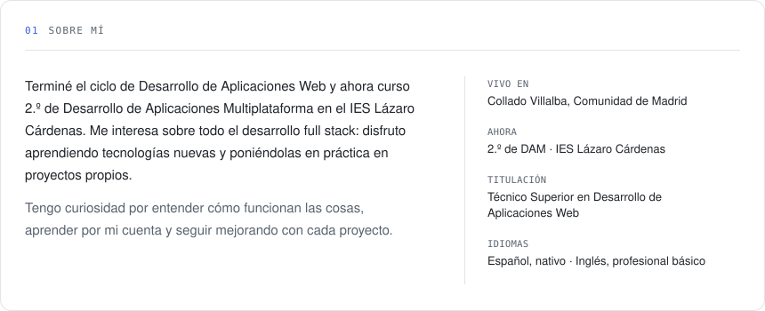</picture>
<picture><source media="(max-width: 767px) and (prefers-color-scheme: dark)" srcset="https://raw.githubusercontent.com/Jhonttt/Jhonttt/salida/trayectoria-movil-dark.svg"><source media="(max-width: 767px)" srcset="https://raw.githubusercontent.com/Jhonttt/Jhonttt/salida/trayectoria-movil-light.svg"><source media="(prefers-color-scheme: dark)" srcset="https://raw.githubusercontent.com/Jhonttt/Jhonttt/salida/trayectoria-dark.svg">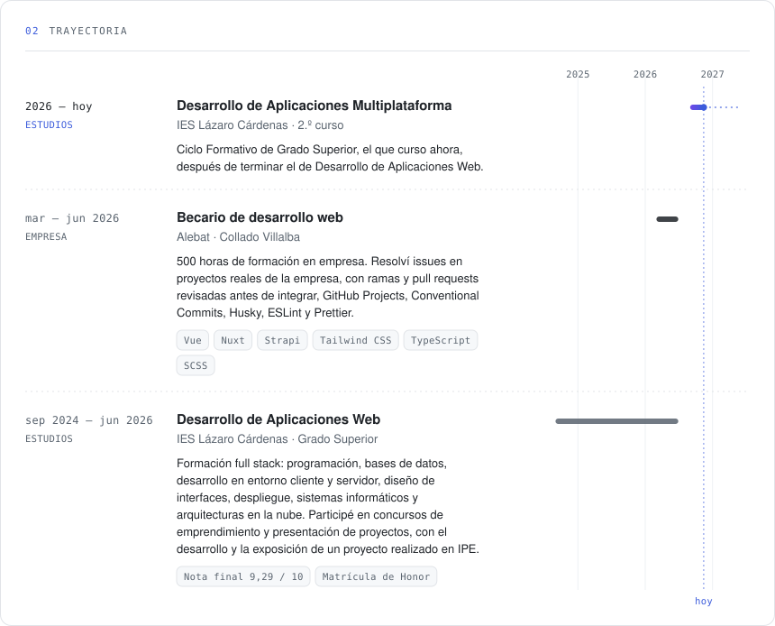</picture>
<picture><source media="(max-width: 767px) and (prefers-color-scheme: dark)" srcset="https://raw.githubusercontent.com/Jhonttt/Jhonttt/salida/stack-movil-dark.svg"><source media="(max-width: 767px)" srcset="https://raw.githubusercontent.com/Jhonttt/Jhonttt/salida/stack-movil-light.svg"><source media="(prefers-color-scheme: dark)" srcset="https://raw.githubusercontent.com/Jhonttt/Jhonttt/salida/stack-dark.svg">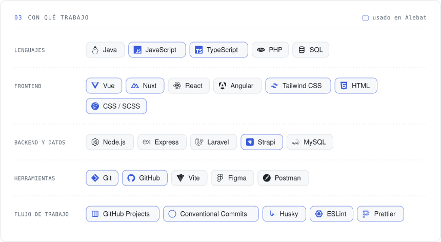</picture>
<picture><source media="(max-width: 767px) and (prefers-color-scheme: dark)" srcset="https://raw.githubusercontent.com/Jhonttt/Jhonttt/salida/proyectos-movil-dark.svg"><source media="(max-width: 767px)" srcset="https://raw.githubusercontent.com/Jhonttt/Jhonttt/salida/proyectos-movil-light.svg"><source media="(prefers-color-scheme: dark)" srcset="https://raw.githubusercontent.com/Jhonttt/Jhonttt/salida/proyectos-dark.svg">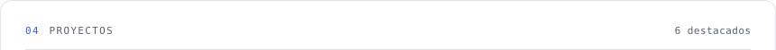</picture><a href="https://serena-app-rust.vercel.app"><picture><source media="(max-width: 767px) and (prefers-color-scheme: dark)" srcset="https://raw.githubusercontent.com/Jhonttt/Jhonttt/salida/proyecto-1-movil-dark.svg"><source media="(max-width: 767px)" srcset="https://raw.githubusercontent.com/Jhonttt/Jhonttt/salida/proyecto-1-movil-light.svg"><source media="(prefers-color-scheme: dark)" srcset="https://raw.githubusercontent.com/Jhonttt/Jhonttt/salida/proyecto-1-dark.svg">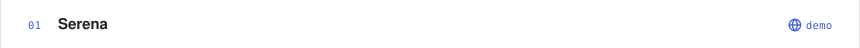</picture></a><a href="https://github.com/Jhonttt/di-dashboard-gestion-incidencias-atahona-sergeev"><picture><source media="(max-width: 767px) and (prefers-color-scheme: dark)" srcset="https://raw.githubusercontent.com/Jhonttt/Jhonttt/salida/proyecto-2-movil-dark.svg"><source media="(max-width: 767px)" srcset="https://raw.githubusercontent.com/Jhonttt/Jhonttt/salida/proyecto-2-movil-light.svg"><source media="(prefers-color-scheme: dark)" srcset="https://raw.githubusercontent.com/Jhonttt/Jhonttt/salida/proyecto-2-dark.svg">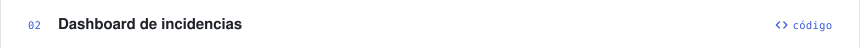</picture></a><a href="https://twitch-clone-opal.vercel.app"><picture><source media="(max-width: 767px) and (prefers-color-scheme: dark)" srcset="https://raw.githubusercontent.com/Jhonttt/Jhonttt/salida/proyecto-3-movil-dark.svg"><source media="(max-width: 767px)" srcset="https://raw.githubusercontent.com/Jhonttt/Jhonttt/salida/proyecto-3-movil-light.svg"><source media="(prefers-color-scheme: dark)" srcset="https://raw.githubusercontent.com/Jhonttt/Jhonttt/salida/proyecto-3-dark.svg">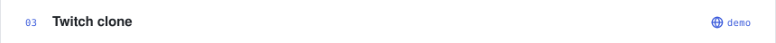</picture></a><a href="https://github.com/Jhonttt/proyecto-intermodular"><picture><source media="(max-width: 767px) and (prefers-color-scheme: dark)" srcset="https://raw.githubusercontent.com/Jhonttt/Jhonttt/salida/proyecto-4-movil-dark.svg"><source media="(max-width: 767px)" srcset="https://raw.githubusercontent.com/Jhonttt/Jhonttt/salida/proyecto-4-movil-light.svg"><source media="(prefers-color-scheme: dark)" srcset="https://raw.githubusercontent.com/Jhonttt/Jhonttt/salida/proyecto-4-dark.svg">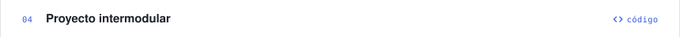</picture></a><a href="https://juanatahona.dev"><picture><source media="(max-width: 767px) and (prefers-color-scheme: dark)" srcset="https://raw.githubusercontent.com/Jhonttt/Jhonttt/salida/proyecto-5-movil-dark.svg"><source media="(max-width: 767px)" srcset="https://raw.githubusercontent.com/Jhonttt/Jhonttt/salida/proyecto-5-movil-light.svg"><source media="(prefers-color-scheme: dark)" srcset="https://raw.githubusercontent.com/Jhonttt/Jhonttt/salida/proyecto-5-dark.svg">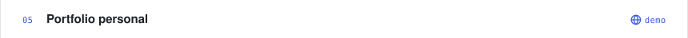</picture></a><a href="https://github.com/Jhonttt/diw-u2-localhub-atahona-toro"><picture><source media="(max-width: 767px) and (prefers-color-scheme: dark)" srcset="https://raw.githubusercontent.com/Jhonttt/Jhonttt/salida/proyecto-6-movil-dark.svg"><source media="(max-width: 767px)" srcset="https://raw.githubusercontent.com/Jhonttt/Jhonttt/salida/proyecto-6-movil-light.svg"><source media="(prefers-color-scheme: dark)" srcset="https://raw.githubusercontent.com/Jhonttt/Jhonttt/salida/proyecto-6-dark.svg">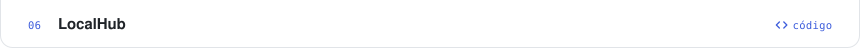</picture></a>
<picture><source media="(max-width: 767px) and (prefers-color-scheme: dark)" srcset="https://raw.githubusercontent.com/Jhonttt/Jhonttt/salida/actividad-movil-dark.svg"><source media="(max-width: 767px)" srcset="https://raw.githubusercontent.com/Jhonttt/Jhonttt/salida/actividad-movil-light.svg"><source media="(prefers-color-scheme: dark)" srcset="https://raw.githubusercontent.com/Jhonttt/Jhonttt/salida/actividad-dark.svg"></picture>
 Generado con Python desde <a href="datos/perfil.json"><code>datos/perfil.json</code></a> · la actividad se actualiza sola cada hora

