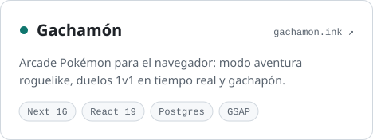
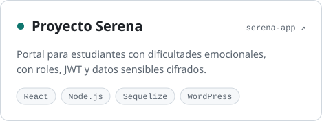
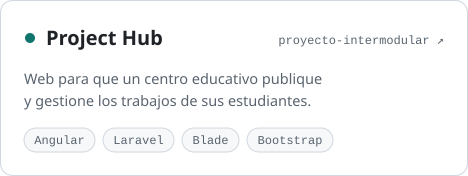
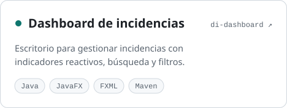

<a href="https://juanatahona.dev">
  <picture>
    <source media="(prefers-color-scheme: dark)" srcset="assets/banner-dark.svg">
    <source media="(prefers-color-scheme: light)" srcset="assets/banner-light.svg">
    
  </picture>
</a>

  

&nbsp;
&nbsp;

 

### Sobre mí

Desarrollador fullstack. Me gusta llevar una idea de principio a fin: el modelo de
datos, la API, la interfaz y el despliegue, con el mismo cuidado en cada capa.

- **Ahora mismo:** construyo [Gachamón](https://www.gachamon.ink), una arcade
  Pokémon para el navegador con Next 16, React 19 y Postgres en Neon.
- **Formación:** desarrollo de aplicaciones web y multiplataforma (DAW · DAM).
- **Certificado en AWS** y con disponibilidad para trabajar en remoto.

 

### Stack

<table>
  <tr>
    <td width="130"><b>FRONTEND</b></td>
    <td>
      <picture>
        <source media="(prefers-color-scheme: dark)" srcset="https://skillicons.dev/icons?i=react,nextjs,vue,nuxtjs,angular,ts,tailwind,html,css&theme=dark&perline=9">
        
      </picture>
    </td>
  </tr>
  <tr>
    <td><b>BACKEND</b></td>
    <td>
      <picture>
        <source media="(prefers-color-scheme: dark)" srcset="https://skillicons.dev/icons?i=nodejs,express,laravel,php,java&theme=dark">
        
      </picture>
    </td>
  </tr>
  <tr>
    <td><b>DATOS</b></td>
    <td>
      <picture>
        <source media="(prefers-color-scheme: dark)" srcset="https://skillicons.dev/icons?i=postgres,mysql,mongodb&theme=dark">
        
      </picture>
    </td>
  </tr>
  <tr>
    <td><b>HERRAMIENTAS</b></td>
    <td>
      <picture>
        <source media="(prefers-color-scheme: dark)" srcset="https://skillicons.dev/icons?i=aws,vercel,git,github,githubactions,vitest,figma&theme=dark">
        
      </picture>
    </td>
  </tr>
</table>

 

### Proyectos destacados

  <a href="https://www.gachamon.ink">
    <picture>
      <source media="(prefers-color-scheme: dark)" srcset="assets/gachamon-dark.svg">
      
    </picture>
  </a>
  <a href="https://serena-app-rust.vercel.app">
    <picture>
      <source media="(prefers-color-scheme: dark)" srcset="assets/serena-dark.svg">
      
    </picture>
  </a>
  <a href="https://github.com/Jhonttt/proyecto-intermodular">
    <picture>
      <source media="(prefers-color-scheme: dark)" srcset="assets/project-hub-dark.svg">
      
    </picture>
  </a>
  <a href="https://github.com/Jhonttt/di-dashboard-gestion-incidencias-atahona">
    <picture>
      <source media="(prefers-color-scheme: dark)" srcset="assets/incidencias-dark.svg">
      
    </picture>
  </a>

 

Juan Atahona · España · <a href="https://juanatahona.dev">juanatahona.dev</a>

