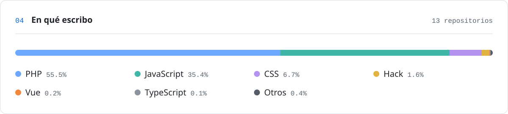

<!--
  Este README casi no tiene texto: todo lo que se ve son SVG generados por
  scripts/ desde datos/perfil.json. Para cambiar algo, edita ese JSON; el
  workflow "Perfil" vuelve a dibujarlo todo (y cada día refresca la actividad).
-->

<picture>
  <source media="(prefers-color-scheme: dark)" srcset="assets/banner-dark.svg">
  
</picture>

  

<a href="https://juanatahona.dev"><picture><source media="(prefers-color-scheme: dark)" srcset="assets/boton-web-dark.svg"></picture></a>&nbsp;
<a href="https://www.linkedin.com/in/juan-atahona/"><picture><source media="(prefers-color-scheme: dark)" srcset="assets/boton-linkedin-dark.svg"></picture></a>&nbsp;
<a href="mailto:juan.atahona4@gmail.com"><picture><source media="(prefers-color-scheme: dark)" srcset="assets/boton-email-dark.svg"></picture></a>

  

<picture>
  <source media="(prefers-color-scheme: dark)" srcset="assets/sobre-mi-dark.svg">
  
</picture>

  

<picture>
  <source media="(prefers-color-scheme: dark)" srcset="assets/stack-dark.svg">
  
</picture>

  

<picture>
  <source media="(prefers-color-scheme: dark)" srcset="assets/actividad-dark.svg">
  
</picture>

  

<picture>
  <source media="(prefers-color-scheme: dark)" srcset="assets/lenguajes-dark.svg">
  
</picture>

  

Generado con Python desde <a href="datos/perfil.json"><code>datos/perfil.json</code></a> · la actividad se actualiza sola cada día

